# Online Shopper Purchase Prediction

[](https://github.com/akriti-adarsh/online-shopper-purchase-prediction/actions/workflows/validate.yml)

A reproducible comparison of five classifiers for identifying shopping sessions that end in a purchase. The project includes an executed notebook, fitted preprocessing and model pipelines, labeled test data, evaluation tables, visual results, and an interactive Streamlit application.

**Main finding:** the Decision Tree achieves the highest purchase F1 (**0.6167**) on the shared test split, with **0.8921 accuracy**, **0.9129 ROC AUC**, and **0.5585 MCC**. These results describe this experiment; they do not establish performance on future traffic.

## 1. Problem statement

The task is binary classification: predict whether an online shopping session produces a transaction from its recorded browsing activity and visitor context. `Revenue = True` is the positive class, representing a purchase; `Revenue = False` represents a session without a purchase.

Purchase sessions are a minority of the data. A model can therefore achieve high accuracy while identifying few buyers. This comparison uses **purchase F1 as the primary ranking measure**, with MCC as a tiebreaker, and reports accuracy, ROC AUC, precision, recall, and MCC to make the tradeoffs visible.

Logistic Regression, Decision Tree, k-Nearest Neighbors, Gaussian Naive Bayes, and Support Vector Machine use identical training and test rows. The experiment assesses their relative behavior on recorded sessions. An early-session intervention would require a separate evaluation of which features are available when the prediction is made.

## 2. Dataset description

The project uses the **Online Shoppers Purchasing Intention Dataset**, published by C. Sakar and Y. Kastro through the [UCI Machine Learning Repository](https://doi.org/10.24432/C5F88Q). Each record describes one shopping session. The source data is distributed under [CC BY 4.0](https://creativecommons.org/licenses/by/4.0/); attribution and the original file checksum are recorded in [data/README.md](data/README.md).

| Property | Value |
|---|---:|
| Sessions | 12,330 |
| Input features | 17 |
| Numerical inputs | 10 |
| Categorical inputs | 7 |
| Target | `Revenue` |
| Purchase sessions | 1,908 (15.47%) |
| Nonpurchase sessions | 10,422 (84.53%) |
| Missing values | 0 |
| Exact duplicate rows beyond their first occurrence | 125 |

The original records, including duplicate rows, are retained to preserve the experiment's split. **29 test rows share feature values with training rows**, representing 22 distinct feature patterns. Source row indices remain disjoint. Duplicate counts and overlap between the partitions are reported in [results/data_quality.json](results/data_quality.json); matching feature patterns are a limitation of this benchmark.

### Input features

The feature groups below cover all 17 predictors. Integer category identifiers are treated as categories, rather than as quantities with meaningful distances.

| Features | Meaning | Processing |
|---|---|---|
| `Administrative`, `Administrative_Duration` | Administrative page count and duration | Standard scaling |
| `Informational`, `Informational_Duration` | Informational page count and duration | Standard scaling |
| `ProductRelated`, `ProductRelated_Duration` | Product page count and duration | Standard scaling |
| `BounceRates`, `ExitRates` | Page-level bounce and exit measures | Standard scaling |
| `PageValues` | Page value associated with transaction activity | Standard scaling |
| `SpecialDay` | Proximity to a special shopping day | Standard scaling |
| `Month` | Session month | One-hot encoding |
| `OperatingSystems`, `Browser`, `Region`, `TrafficType` | Coded session context | One-hot encoding |
| `VisitorType` | Visitor category | One-hot encoding |
| `Weekend` | Weekend indicator | One-hot encoding |

### Shared evaluation split

A stratified 80/20 split with `random_state=42` preserves the approximate purchase proportion. `Revenue` is retained in the exported CSV for scoring and excluded from model inputs.

| Partition | Sessions | Purchases | Nonpurchases | Purchase rate |
|---|---:|---:|---:|---:|
| Training | 9,864 | 1,526 | 8,338 | 15.47% |
| Held-out test | 2,466 | 382 | 2,084 | 15.49% |

On this test set, always predicting “no purchase” produces **84.51% accuracy and 0% purchase recall**. This reference explains why accuracy alone is insufficient.

## 3. GitHub repository link

[akriti-adarsh/online-shopper-purchase-prediction](https://github.com/akriti-adarsh/online-shopper-purchase-prediction)

The analysis is available in [model/Online_Shoppers_Model_Analysis.ipynb](model/Online_Shoppers_Model_Analysis.ipynb). The interactive evaluation interface starts from [app.py](app.py); local usage and deployment settings are described below.

## 4. Models used

### Preprocessing and configuration

Each classifier is stored in a scikit-learn `Pipeline` with its own fitted `ColumnTransformer`. Numerical inputs use `StandardScaler`; categorical inputs use `OneHotEncoder(handle_unknown="ignore")`. The combined transformed output is dense for compatibility with Gaussian Naive Bayes.

The scaler and encoder learn only from training rows. Test rows use those fitted transformations. Keeping preprocessing inside each saved pipeline ensures the same transformations apply when the model is reloaded.

| Model | Explicit settings | Role in the comparison |
|---|---|---|
| Logistic Regression | `max_iter=1000`, `random_state=42` | Linear reference model |
| Decision Tree | `max_depth=7`, `min_samples_leaf=15`, `random_state=42` | Nonlinear rules with constrained tree growth |
| k-Nearest Neighbors | `n_neighbors=11` | Classification from nearby training sessions |
| Gaussian Naive Bayes | `var_smoothing=0.001` | Probabilistic classifier with variance smoothing |
| Support Vector Machine | `kernel="rbf"`, `C=1.0` | Nonlinear margin-based classifier |

Other settings use the defaults of the pinned library version. The experiment does not perform hyperparameter search, resampling, class weighting, or threshold optimization.

### Metric definitions

Precision, recall, and F1 refer to the **purchase class**. Predicted labels come from each estimator's `predict` method at its default decision rule.

| Metric | Interpretation |
|---|---|
| Accuracy | Share of all sessions classified correctly |
| ROC AUC | Ability to rank purchases above nonpurchases across thresholds |
| Precision | Share of predicted purchases that are actual purchases |
| Recall | Share of actual purchases identified |
| F1 | Harmonic mean of purchase precision and recall |
| MCC | Correlation between predicted and observed classes, using all four confusion-matrix counts |

ROC AUC uses purchase probabilities for the first four models and `decision_function` scores for the SVM. SVM scores are ranking values, not calibrated probabilities. MCC ranges from −1 to 1; the other metrics range from 0 to 1. Higher values are better for all six metrics.

### Performance comparison

All models are evaluated on the same **2,466 test sessions**. Values are rounded to four decimal places; [model_comparison.csv](results/model_comparison.csv) retains the underlying numerical results.

| Model | Accuracy | ROC AUC | Precision | Recall | F1 | MCC |
|---|---:|---:|---:|---:|---:|---:|
| Logistic Regression | 0.8808 | 0.8828 | **0.7366** | 0.3586 | 0.4824 | 0.4592 |
| Decision Tree | **0.8921** | **0.9129** | 0.6859 | 0.5602 | **0.6167** | **0.5585** |
| k-Nearest Neighbors | 0.8731 | 0.8164 | 0.6927 | 0.3246 | 0.4421 | 0.4159 |
| Gaussian Naive Bayes | 0.6403 | 0.7681 | 0.2723 | **0.7906** | 0.4051 | 0.2934 |
| Support Vector Machine | 0.8873 | 0.8824 | 0.7047 | 0.4686 | 0.5629 | 0.5149 |

**Bold values identify the highest score in each column.**

## 5. Model observations

| Model | Observation on this test split |
|---|---|
| Logistic Regression | Highest precision: 137 of its 186 purchase alerts are correct. However, it misses 245 buyers, giving 35.86% recall. It produces relatively few false purchase alerts. |
| Decision Tree | Identifies 214 buyers with 98 false alerts. Compared with Logistic Regression, it catches 77 more buyers at the cost of 49 more false alerts. It leads on accuracy, ROC AUC, F1, and MCC. |
| k-Nearest Neighbors | Identifies 124 buyers and misses 258. Precision is 69.27%, but recall is 32.46%, the lowest in the comparison. Its high overall accuracy masks weak purchase detection. |
| Gaussian Naive Bayes | Identifies the most buyers: 302 of 382. It also produces 807 false alerts; just 27.23% of purchase alerts are correct. Its recall advantage comes with a substantial precision cost. |
| Support Vector Machine | Identifies 179 buyers with 75 false alerts. Compared with the tree, it produces 23 fewer false alerts but misses 35 additional buyers. Its F1 is second highest at 0.5629. |
| **Overall winner** | **Decision Tree**, under the F1-first rule. Its F1 of **0.6167** and MCC of **0.5585** provide the strongest balance in this experiment. This is a selection from one shared test split, not an independent estimate after model selection. |

### Errors in session counts

| Model | True negatives | False positives | False negatives | True positives |
|---|---:|---:|---:|---:|
| Logistic Regression | 2,035 | 49 | 245 | 137 |
| Decision Tree | 1,986 | 98 | 168 | 214 |
| k-Nearest Neighbors | 2,029 | 55 | 258 | 124 |
| Gaussian Naive Bayes | 1,277 | 807 | 80 | 302 |
| Support Vector Machine | 2,009 | 75 | 203 | 179 |

A false positive is a nonpurchase session labeled as a purchase. A false negative is a purchase labeled as a nonpurchase. Every row sums to 2,466; true positives plus false negatives sum to 382 buyers. These counts are also available in [error_counts.csv](results/error_counts.csv).

## 6. Visual results

The notebook presents seven coordinated visual summaries, formatted data and metric tables, and expanded explanations of each model's strengths and tradeoffs. The 3D views supplement the exact tables and flat comparison charts; the model configurations, split, and six required evaluation metrics remain the same.

### Class distribution

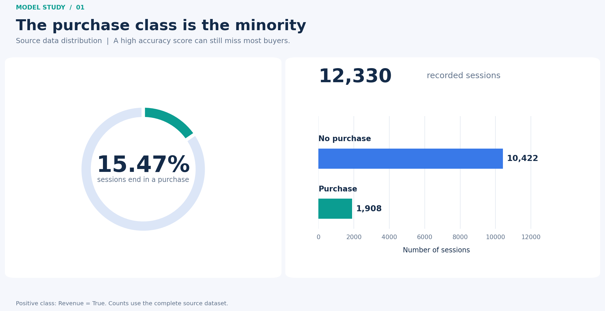

The minority purchase class makes precision and recall essential companions to accuracy.

### Comparison across models

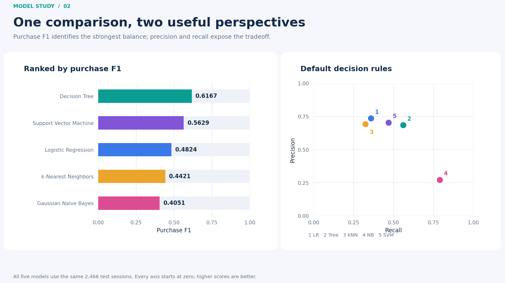

The comparison highlights the Decision Tree's balance and Gaussian Naive Bayes' recall tradeoff.

### Model performance in three dimensions

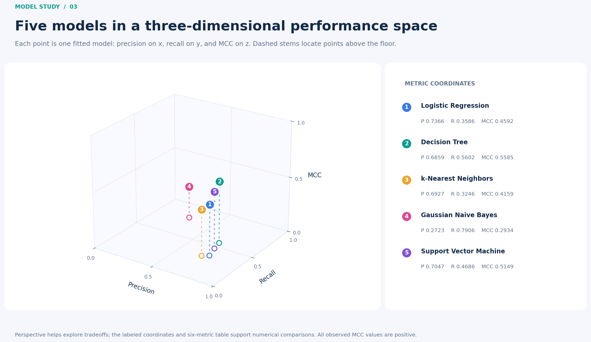

Each point represents one fitted model: precision is the horizontal axis, recall is the depth axis, and MCC is the vertical axis. Labels and the accompanying values identify the models without relying on perspective alone. This view brings three existing evaluation metrics together; it does not introduce a new ranking rule.

### Confusion matrices

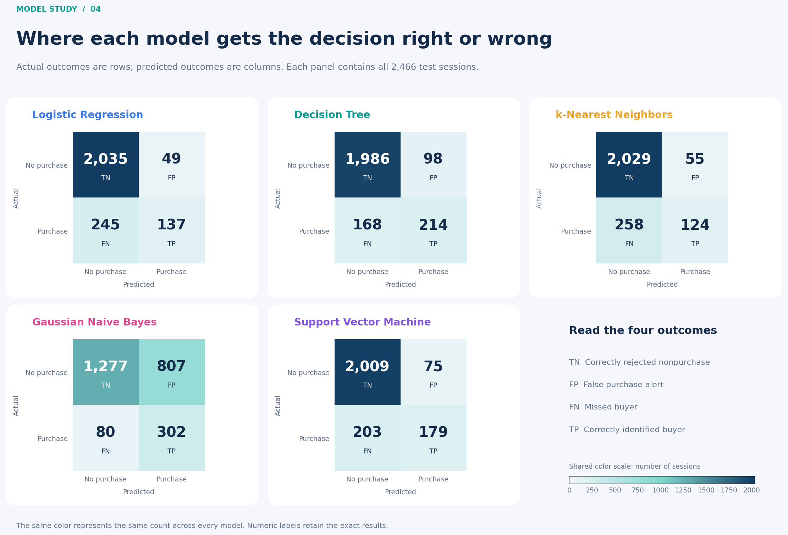

All panels share one color scale. The upper-right cell counts false purchase alerts; the lower-left cell counts missed buyers.

### Confusion counts in three dimensions

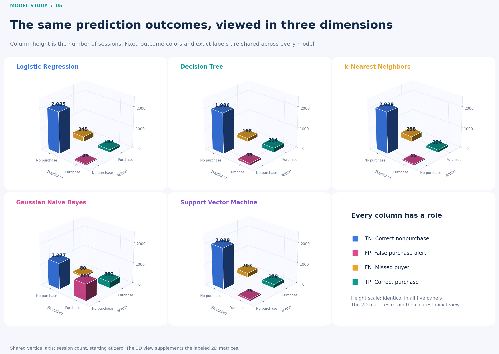

Bar heights represent session counts, with the same vertical scale across all five models. The four outcomes retain consistent colors and exact count labels. The flat matrices and error-count table above remain available for direct numerical comparison.

### ROC curves

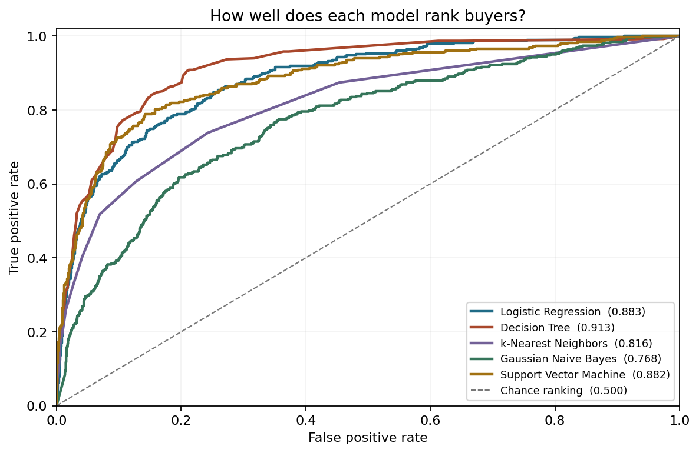

The diagonal is the chance-ranking reference. ROC AUC evaluates ranking across thresholds; it does not describe precision at the default operating point.

### Precision and recall across thresholds

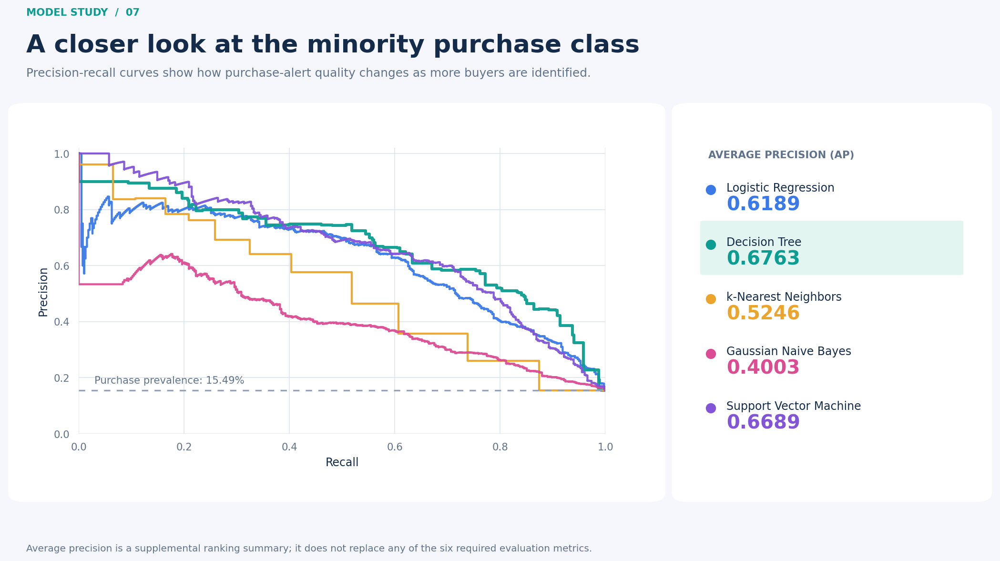

These curves show how purchase precision changes as more buyers are identified. The reference level is the purchase proportion in the held-out set. Average precision (AP) summarizes each curve as a supplementary measure for the minority purchase class; it does not replace ROC AUC or any of the six required metrics.

## 7. Reproduce the experiment

### Environment setup

Use **Python 3.12**. From a terminal:

```bash
git clone https://github.com/akriti-adarsh/online-shopper-purchase-prediction.git
cd online-shopper-purchase-prediction
python -m venv .venv
```

Activate the environment on Windows PowerShell:

```powershell
.\.venv\Scripts\Activate.ps1
```

Or on macOS/Linux:

```bash
source .venv/bin/activate
```

Install the analysis and notebook dependencies:

```bash
python -m pip install -r requirements-dev.txt
```

[requirements.txt](requirements.txt) pins modeling, reporting, and application dependencies. [requirements-dev.txt](requirements-dev.txt) adds notebook execution and editing tools. The versions used to generate the committed models are recorded in [training_versions.txt](results/training_versions.txt).

### Regenerate the outputs

```bash
python scripts/run_analysis.py
python scripts/verify_artifacts.py
```

The analysis command executes the notebook and rebuilds the reports from the repository's source dataset. It regenerates the split CSV files, fits all five pipelines, exports their models, and refreshes the results. This overwrites generated experiment outputs; inspect the Git diff after rerunning it.

To inspect or execute the notebook interactively:

```bash
python -m jupyterlab model/Online_Shoppers_Model_Analysis.ipynb
```

The source dataset is included, so a fresh clone does not depend on a separate download. `train_data.csv` is reproducible and ignored by Git; the labeled `test_data.csv` is tracked for evaluation and the application.

### Validate existing artifacts

```bash
python scripts/verify_artifacts.py
python -m unittest discover -s tests -v
```

Artifact verification reloads the saved pipelines and checks their results against the recorded experiment. It also checks the notebook's formatted comparison table, embedded figures, and exported visual files. The application tests exercise dataset validation, model evaluation, and the Streamlit controls. The [validation workflow](.github/workflows/validate.yml) runs both checks in GitHub Actions. The experiment manifest and data-quality report retain provenance and split information for inspection.

Serialized pipelines depend on their library versions. Use the pinned environment when loading the committed `.joblib` files. If dependencies change, regenerate the complete set of models and reports together; see scikit-learn's [model persistence guidance](https://scikit-learn.org/stable/model_persistence.html).

## 8. Repository contents

| Path | Purpose |
|---|---|
| `README.md` | Problem, dataset, methods, findings, and reproduction instructions |
| `app.py` | Streamlit interface for evaluating and comparing the five saved models |
| `shopper_app/evaluation.py` | CSV validation, saved-pipeline loading, and evaluation calculations |
| `shopper_app/charts.py` | Interactive charts for metrics, errors, and model comparisons |
| `shopper_app/appearance.py`, `assets/appearance.js` | Browser appearance preference, system-theme detection, and chart-theme synchronization |
| `shopper_app/presentation.py` | Shared presentation helpers for the application |
| `shopper_app/explorer.py` | Session filtering, ordering, pagination, and export preparation |
| `shopper_app/session_table.py`, `assets/session-table.js` | Interactive session table and session-detail selection |
| `assets/app.css`, `assets/brand.svg` | Shared visual design and application mark |
| `.streamlit/config.toml` | Application theme and server configuration |
| `requirements.txt` | Pinned modeling, reporting, and application dependencies |
| `requirements-dev.txt` | Notebook execution and editing dependencies |
| `data/online_shoppers_intention.csv` | Original dataset for repeatable execution |
| `data/README.md` | Dataset attribution, license, and checksum |
| `model/Online_Shoppers_Model_Analysis.ipynb` | Executed analysis with five models, formatted tables, seven charts, and model explanations |
| `model/logistic_regression.joblib` | Fitted Logistic Regression pipeline |
| `model/decision_tree.joblib` | Fitted Decision Tree pipeline |
| `model/k_nearest_neighbors.joblib` | Fitted k-Nearest Neighbors pipeline |
| `model/gaussian_naive_bayes.joblib` | Fitted Gaussian Naive Bayes pipeline |
| `model/support_vector_machine.joblib` | Fitted SVM pipeline |
| `test_data.csv` | Shared labeled test set, including `Revenue` |
| `results/model_comparison.csv` | Six evaluation metrics for every model |
| `results/error_counts.csv` | Confusion-matrix counts for every model |
| `results/*.png` | Seven visual summaries, including two 3D views, embedded above |
| `results/training_versions.txt` | Package versions recorded during execution |
| `results/experiment_manifest.json` | Experiment provenance and artifact metadata |
| `results/data_quality.json` | Data quality and partition-overlap information |
| `scripts/run_analysis.py` | Entry point for rerunning the notebook and reports |
| `scripts/build_report.py` | Builds supplementary tables and visual reports |
| `scripts/notebook_visuals.py` | Shared styling and chart functions used by the notebook and exported reports |
| `scripts/notebook_tables.py` | Consistent table images with expandable, selectable HTML values |
| `scripts/verify_artifacts.py` | Checks saved models and reported results |
| `tests/test_evaluation.py` | Validation edge cases and saved-model result checks |
| `tests/test_app.py` | Streamlit interaction and displayed-result checks |
| `tests/test_explorer.py`, `tests/test_charts.py` | Session identity, filtering, curve calculations, metric ranking, and chart presentation checks |
| `docs/validation.md` | Recorded automated and browser checks, reference values, and verification limits |
| `docs/screenshots/` | Desktop and mobile screenshots in light and dark appearances |
| `.github/workflows/validate.yml` | Automated artifact verification and application tests |
| `.gitignore`, `.gitattributes` | Exclude local files and keep file handling consistent |

## 9. Limitations and interpretation

- **One evaluation split.** There are no confidence intervals or repeated-split estimates. Ranking models on this test set also uses it for selection. Further work should select models and tune settings within training data, then evaluate once on an untouched final set.
- **Duplicate records.** The source contains 125 exact duplicate rows beyond their first occurrence. Retaining these rows preserves comparability, but matching feature patterns can cross the split. A separate duplicate-aware evaluation would test sensitivity to that choice.
- **Feature availability.** `PageValues`, durations, and related measures reflect recorded session activity. Their availability and construction must be checked at the intended prediction time before interpreting these results as early purchase prediction.
- **Threshold and cost assumptions.** F1 weights precision and recall equally. It does not encode the business cost of a false alert or missed buyer. Different costs could favor another model or threshold.
- **Historical scope.** A random split does not measure performance on a later period, another retailer, or changed shopping behavior.
- **Model assumptions.** Gaussian Naive Bayes applies conditional independence and Gaussian assumptions to transformed features. Correlated activity measures and encoded categories may depart from those assumptions; probability calibration is not evaluated here.

## 10. Shopper Signals application

**Shopper Signals** is the Streamlit interface for exploring the five saved classifiers. Its four destinations—**Overview**, **Compare Models**, **Session Explorer**, and **About**—share the active dataset and selected model. The interface uses bright cobalt, coral, and mint accents, crisp white surfaces, and a navy dark appearance with the same outcome meanings.

The assignment explicitly requires Streamlit and deployment on Streamlit Community Cloud. The application therefore keeps `app.py` as its entry point and uses the existing Python pipelines directly. The notebook, split, fitted models, and published results remain the scientific reference.

### Run locally

From the repository root, with the Python 3.12 environment activated:

```bash
python -m pip install -r requirements.txt
python -m streamlit run app.py
```

Open the local address printed in the terminal. No Streamlit account is needed for local execution. The application uses the committed fitted pipelines and does not train models during evaluation. The small browser components are served by Streamlit; no separate browser build or production Node.js runtime is required.

### Explore the results

1. Start with the bundled **2,466-session test set** and the **Decision Tree**. The context header identifies the active model and dataset.
2. Change the model to see its six metrics and a finding calculated from its current predictions. Evaluation uses the model's saved decision rule.
3. Open **Evaluation settings** to download the test CSV or schema, inspect upload requirements, and select a different dataset. A valid upload becomes the active dataset; an invalid upload leaves the previous valid dataset available.
4. Use **Compare Models** to evaluate all five classifiers on exactly the same active rows. Select a metric for the ranked chart, inspect the sortable table, and open the optional 3D comparison.
5. Select a confusion-matrix outcome to open the corresponding sessions in **Session Explorer**. Inspect a session's features, adjust filters and ordering, and download the filtered predictions.

| Area | What it provides |
|---|---|
| Overview | A result-based finding; accuracy, ROC AUC, precision, recall, F1, and MCC; an interactive confusion matrix; buyer coverage; ranking curves; and a classification report |
| Compare Models | All five models on the active dataset, a sortable six-metric table, a ranked metric chart, and an optional 3D view |
| Session Explorer | Stable session identifiers, outcomes, model scores, category filters, search, sorting, pagination, session details, and filtered CSV export |
| About | Dataset context, evaluation choices, and interpretation guidance |

The displayed results are calculated from the selected dataset. The notebook comparison above remains the result for the original held-out split; an uploaded dataset may produce different values. Switching pages retains the current model and dataset.

### Read the evaluation correctly

The confusion matrix places **actual outcomes on rows** and **predicted outcomes on columns**. Each cell includes a count, an outcome label, and its standard code. The **Count / % of actual class** control changes the displayed measure; percentages use the total in that actual-outcome row as their denominator. Every cell is also a button that opens its matching sessions.

| Outcome | Meaning | Visual meaning |
|---|---|---|
| True negative (TN) | No purchase occurred and none was predicted | Cobalt blue |
| False positive (FP) | A purchase was predicted, but none occurred | Coral pink |
| False negative (FN) | A purchase occurred, but the model missed it | Amber |
| True positive (TP) | A purchase occurred and was identified | Emerald |

Buyer coverage separates two questions: **recall** is the share of actual buyers identified, `TP / (TP + FN)`; **precision** is the share of purchase predictions that were correct, `TP / (TP + FP)`. The bars display their counts and denominators explicitly.

ROC and precision–recall curves use scores for the **purchase class, `1`**, with reference baselines and accessible numerical summaries. A displayed operating point must agree with the saved model's predictions; the interface does not change the decision threshold. Probability-capable classifiers expose a purchase probability, while SVM exposes an uncalibrated decision score. A larger SVM score ranks a session more strongly toward purchase; it is not a percentage or a calibrated probability.

Single-class labeled files remain usable for prediction and inspection, but ROC AUC and MCC are unavailable. Undefined classification-report values are displayed as unavailable. The published headline precision, recall, and F1 retain the notebook's zero-division convention of `0` when their denominator is zero. Feature-only uploads have no observed outcomes, so their evaluation metrics and error categories are unavailable.

Session identifiers are derived from the normalized dataset and original row position. Filtering, sorting, pagination, and export preserve that identity. The session detail view presents both readable feature labels and original column names; it does not invent feature contributions or explanations for individual predictions.

Filtered CSV exports keep formula-like text literal for spreadsheet use: text beginning with `=`, `+`, `-`, or `@`, including after whitespace, receives a leading apostrophe in the exported file. Original inputs, predictions, and session IDs remain unchanged; numeric values such as negative SVM decision scores remain numeric.

### CSV requirements

Upload a **UTF-8, comma-separated CSV** with all **17 predictors**. Include `Revenue` to evaluate observed outcomes, or omit that column entirely to obtain predictions and scores only. Column order may differ, and surrounding whitespace is stripped. The upload limit is **5 MiB (5,242,880 bytes) and 5,000 rows**.

| Columns | Accepted values |
|---|---|
| `Administrative`, `Informational`, `ProductRelated` | Nonnegative whole-number page counts |
| `Administrative_Duration`, `Informational_Duration`, `ProductRelated_Duration`, `PageValues` | Finite, nonnegative numbers |
| `BounceRates`, `ExitRates`, `SpecialDay` | Numbers between `0` and `1`, inclusive |
| `OperatingSystems`, `Browser`, `Region`, `TrafficType` | Positive integer category codes |
| `Month` | Text category; fitted values are `Aug`, `Dec`, `Feb`, `Jul`, `June`, `Mar`, `May`, `Nov`, `Oct`, and `Sep` |
| `VisitorType` | Text category; fitted values are `New_Visitor`, `Other`, and `Returning_Visitor` |
| `Weekend` | `True`/`False` or `1`/`0` |
| `Revenue` | Optional outcome column: `True`/`False` or `1`/`0`; required for evaluation |

Boolean values are case-insensitive. Text categories retain their capitalization. Valid categories unseen during fitting are accepted with a warning; the saved encoder ignores their unknown category indicators. Repeated records are retained and reported rather than silently removed.

Missing values, duplicate column names, missing required predictors, extra columns, malformed CSV records, and invalid numeric or Boolean values are rejected before activation. Validation messages identify the affected columns and applicable CSV row numbers without reproducing row contents. A partially filled `Revenue` column is invalid: provide all outcomes or remove the column for prediction-only use.

The settings panel provides the bundled test CSV as a working example and a downloadable schema generated from the same field rules used by validation. The uploaded filename, row count, and preview help confirm the active data. Invalid uploads retain the previous valid dataset and its results.

### Architecture and data handling

| Layer | Responsibility |
|---|---|
| Streamlit interface | Navigation, active dataset/model state, evaluation controls, metric displays, session details, and downloads |
| Evaluation module | Schema validation, normalized dataset identity, trusted model loading, positive-class scores, metrics, and prediction records |
| Explorer and table modules | Consistent filtering, ordering, pagination, stable row selection, and filtered export |
| Chart and presentation modules | Shared outcome meanings, metric comparisons, ranking curves, and visual summaries |
| Appearance component and shared assets | System/Light/Dark preference, browser-to-Python theme state, focus restoration, and shared visual styling |

Uploaded data and computed results stay in the current application session. The app does not write uploaded CSVs to disk or place their rows in a shared result cache. Only the packaged model pipelines are shared through the model cache. Evaluation-cache identity includes the dataset, fitted classifier, and fitted preprocessing, so changing any of those inputs invalidates the relevant result.

The application loads only its five registered local `.joblib` files after checking their hashes against the experiment manifest. Uploaded model files and arbitrary serialized objects are not accepted. Predictions always use the fitted preprocessing and saved decision rules; there is no training or model replacement through the interface.

### Appearance and accessibility

**System** is the default appearance and follows the browser's operating-system preference. **Light** and **Dark** selections are stored in browser local storage and restored on reload; a blocked storage API leaves the control usable for the current session. System changes are observed while System is selected. The resolved appearance is sent to Python so Plotly charts use the same palette as the page.

Streamlit controls the initial page bootstrap. The preference is restored when the appearance component mounts, and the initial server render uses the light palette until the browser reports its preference. A brief initial mismatch is possible; the application does not promise a theme change before the first browser paint.

The design targets **WCAG 2.2 AA** with labeled controls, visible focus, keyboard-operable outcome buttons, outcome text alongside color, reduced-motion support, and responsive layouts. Session details can be opened from the table or an alternative keyboard selector. These measures are an implementation target, not a certification of the entire interface.

The specified palette's base text pairs were checked using relative luminance:

| Text/background pair | Light contrast | Dark contrast |
|---|---:|---:|
| Main text on page | 14.88:1 | 17.43:1 |
| Secondary text on page | 6.74:1 | 10.32:1 |
| Action text on action background | 5.23:1 | 7.88:1 |
| Highlight text on highlight background | 5.23:1 | 5.23:1 |

These checks cover those exact color pairs. They do not establish contrast for every widget state, chart mark, or browser-rendered table. The [validation record](docs/validation.md) distinguishes completed browser and keyboard checks from the unverified 200% zoom and assistive-technology checks.

### Validate the application

From the repository root, install the development dependencies before running the checks:

```bash
python -m pip install -r requirements-dev.txt
python -m compileall -q app.py shopper_app
python -m ruff check app.py shopper_app tests
python -m unittest discover -s tests -v
python scripts/verify_artifacts.py
```

Run the dependency-free browser-component regression tests with Node.js 22 or newer:

```bash
node --test tests/test_components.mjs
```

The recorded local validation passed **64 Python tests and 4 browser-component tests**, Ruff **0.17.3**, Python compilation, JavaScript syntax checks, and verification of **21 artifact checksums**. All five models reproduced their six published metrics and confusion-matrix counts. The component tests exercise focus visibility, tab order, and delayed target rendering; interactive browser checks supplement them because Python's Streamlit test runner does not execute JavaScript. Node.js is needed only for these development checks, not to run or deploy the app.

Live browser checks confirmed the k-Nearest Neighbors reference results, its 258-row missed-buyer drill-down and export, keyboard session details, valid and feature-only uploads, invalid-upload recovery, five-model MCC comparison, and dark appearance after reload. Layout checks found no page-level horizontal overflow at widths of **360, 390, 768, 1024, and 1440 pixels**. The 390-pixel mobile check also covered settings and detail-dialog bounds, section ordering, and keyboard interaction.

**Verification limits:** the attempted zoom shortcut had no effect in the embedded browser, so **200% zoom remains unverified**. Assistive-technology testing and a complete WCAG audit have not been performed. Cloud deployment is also pending. See the [full validation record](docs/validation.md) for the checked scenarios, exact reference values, and remaining checks.

### Interface screenshots

The linked images show local desktop and mobile views in both appearances. Desktop frames are 1440 × 1360 pixels; mobile frames are 390 × 1680 pixels to show more of the page. Normal mobile interaction was also checked at 390 × 844 pixels.

| Light appearance | Dark appearance |
|---|---|
| <a href="docs/screenshots/desktop-light.png">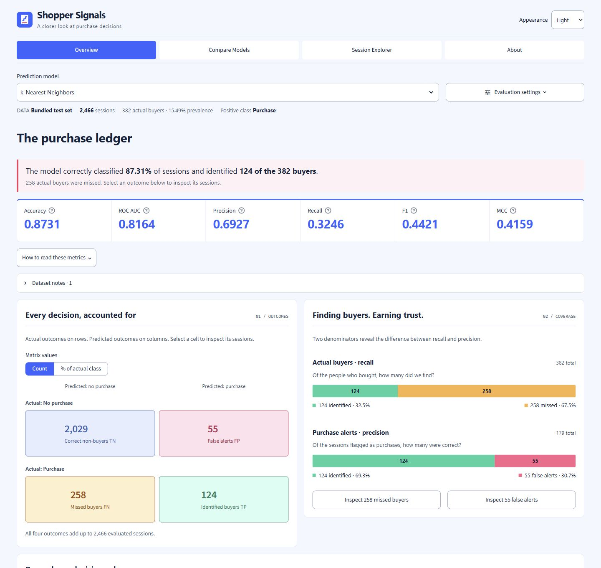</a> | <a href="docs/screenshots/desktop-dark.png">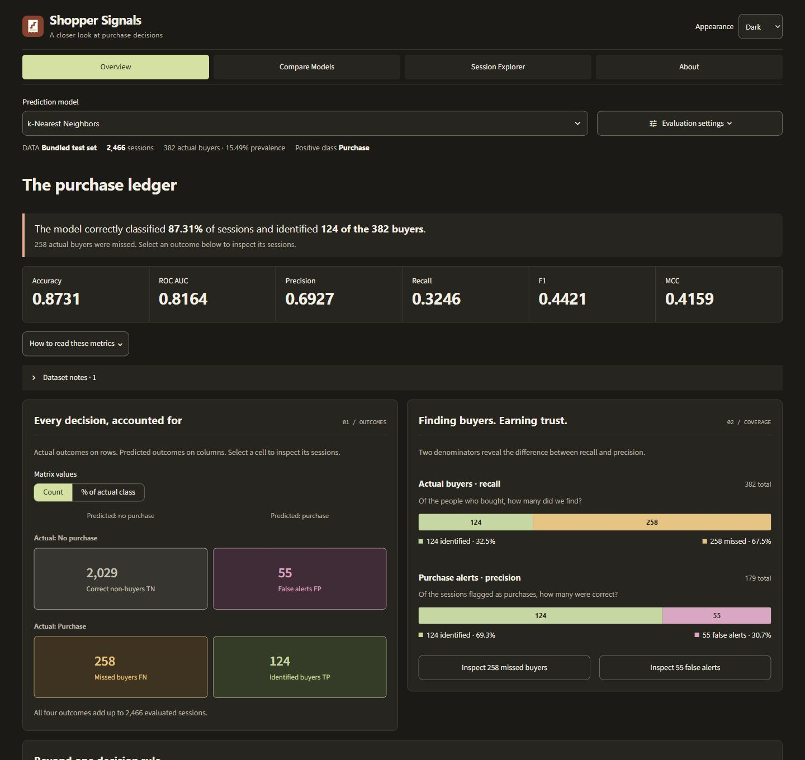</a> |
| <a href="docs/screenshots/mobile-light.png">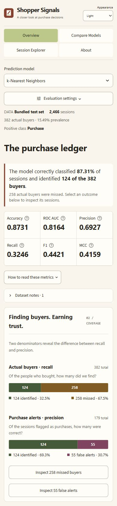</a> | <a href="docs/screenshots/mobile-dark.png">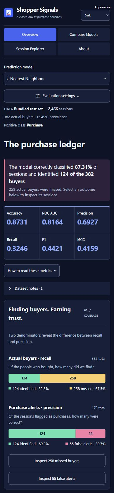</a> |

### Deploy to Streamlit Community Cloud

**Deployment status: not yet deployed.** The public application link will be added after deployment and a check of the hosted interface.

Sign in to [Streamlit Community Cloud](https://share.streamlit.io/) and connect the GitHub account that can access this repository. Create an app with these settings:

| Setting | Value |
|---|---|
| Repository | `akriti-adarsh/online-shopper-purchase-prediction` |
| Branch | `main` |
| Main file path | `app.py` |
| Python version in Advanced settings | `3.12` |

The app requires no service keys or secrets. After deployment, check all five models with the included test set, test the upload path, and confirm that the public link opens correctly. Streamlit's [official deployment guide](https://docs.streamlit.io/deploy/streamlit-community-cloud/deploy-your-app/deploy) describes the repository and Python-version settings.

## 11. Remaining submission steps

- Deploy the application, verify its public link, and add that link to this README.
- Run the assignment in the BITS Virtual Lab and capture the required execution screenshot.
- Prepare the final PDF in the required order: GitHub repository link, live application link, Virtual Lab screenshot, and complete README content.
- Submit the PDF through the course portal and confirm the submission is finalized.

## References

1. Sakar, C., & Kastro, Y. (2018). *Online Shoppers Purchasing Intention Dataset*. UCI Machine Learning Repository. [Dataset DOI](https://doi.org/10.24432/C5F88Q). [Dataset license](https://creativecommons.org/licenses/by/4.0/).
2. Scikit-learn documentation: [Pipelines and composite estimators](https://scikit-learn.org/stable/modules/compose.html).
3. Scikit-learn documentation: [Classification metrics](https://scikit-learn.org/stable/modules/model_evaluation.html#classification-metrics).
4. Scikit-learn documentation: [Model persistence](https://scikit-learn.org/stable/model_persistence.html).
